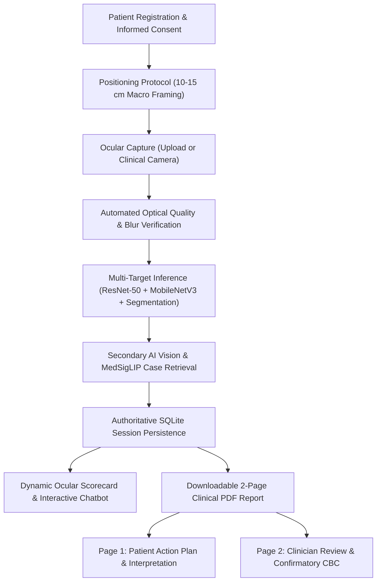

# EyeHealthAI (OcuScan) — Hospital Deployment & Clinical Operations Manual

## 1. System Overview
**EyeHealthAI (OcuScan)** is a non-invasive computer vision decision-support framework designed for rapid ocular biomarker screening across three primary targets:
1. **Model A (ResNet-50 Anemia Regressor)**: Continuous blood hemoglobin estimation (g/dL) via palpebral conjunctiva microvascular pallor.
2. **Model B (MobileNetV3 SLID Classifier)**: Ocular anterior surface hyperemia / conjunctival injection screening (98.78% test accuracy on slit-lamp imaging).
3. **Model C (MobileNetV3 Scleral Icterus Classifier)**: Scleral yellowness categorization (with quantitative bilirubin safety limits intact).
4. **Ocular Tissue Segmentation & MedSigLIP Case Retrieval**: Precise anatomical region masking and nearest-case clinical registry retrieval.
5. **AI Dr. Astra & Multimodal Vision**: Official OpenAI SDK integration for plain-language patient explanations and structured secondary visual assessment.

---

## 2. Infrastructure & Hardware Prerequisites

### Minimum On-Premise Specifications
- **CPU**: 4 Cores (Intel Xeon / AMD EPYC / Core i5+ 10th Gen)
- **RAM**: 8 GB minimum (16 GB recommended for concurrent screening)
- **Storage**: 20 GB SSD
- **OS**: Ubuntu 22.04 LTS / Debian 12 / Windows Server 2022 / RHEL 9
- **Network**: Local Area Network (LAN) binding for hospital workstations or reverse proxy with TLS 1.3.

---

## 3. Production Deployment Options

### Option A: Docker Compose (Recommended)
```bash
# 1. Clone repository or deploy release bundle
git clone https://github.com/Sarthak752008/Eye-Diseases-healthai-research.git
cd Eye-Diseases-healthai-research

# 2. Configure environment variables in .env
cp .env.example .env
# Edit .env to set OPENAI_API_KEY, PORT, etc.

# 3. Launch containerized clinical screening node
docker compose up -d --build

# 4. Verify deployment health
curl http://localhost:8000/api/health
```

### Option B: Native Bare-Metal / Systemd Service
```bash
# 1. Create dedicated virtual environment
python3 -m venv venv
source venv/bin/activate

# 2. Install production dependencies
pip install --upgrade pip
pip install -r requirements.txt

# 3. Launch via Uvicorn with multi-worker ASGI
python -m uvicorn app:app --host 0.0.0.0 --port 8000 --workers 4
```

---

## 4. Patient Intake & Clinical Screening Workflow



---

## 5. Security, Patient Privacy & HIPAA Compliance

1. **Ephemeral Image Ingestion**: Uploaded eye images are processed in memory (RAM). Temporary buffers are flushed upon session finalization.
2. **Cryptographic Provenance**: Every screening session generates a SHA-256 image digest (`input_hashes`) to guarantee traceability back to original capture views without storing unencrypted raw files on publicly accessible endpoints.
3. **Local Deep Learning Forward Pass**: All deep learning models (ResNet-50, MobileNetV3 SLID, Jaundice, Segmentation) run **100% locally on-premise on CPU/GPU**. No image pixels are transmitted externally except when optional multimodal secondary vision is enabled via secure HTTPS TLS 1.3 endpoints.
4. **Security Headers Enforced**:
   - `X-Content-Type-Options: nosniff`
   - `X-Frame-Options: DENY`
   - `Referrer-Policy: strict-origin-when-cross-origin`
   - `Permissions-Policy: camera=(self)`

---

## 6. Clinical Safety Gates & Medical Boundaries

- **Investigational Status**: OcuScan is an adjunct screening tool and **not** an autonomous diagnostic device.
- **Mandatory Confirmatory Venous Blood Panel**: Any flagged anemia reading requires standard laboratory Complete Blood Count (CBC) verification before prescription of therapeutics or iron supplementation.
- **Slit-Lamp Examination**: Ocular surface irritation warnings recommend an in-person slit-lamp biomicroscopy evaluation by a certified ophthalmologist.
